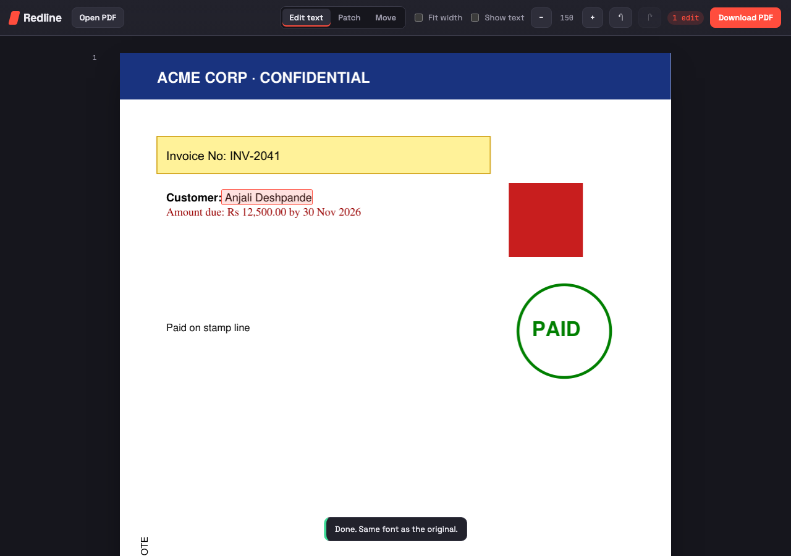
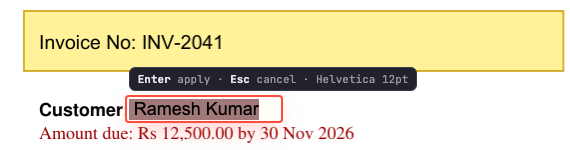
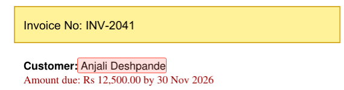

<div align="center">

# 🟥 Redline

### Edit the text in a PDF. Nothing else.

Click any line, retype it, download. Headers, footers, stamps, logos, backgrounds and every other line on the page stay exactly where they were, **including on scanned pages.**




</div>

---

## Why this exists

Editing text in a PDF is finicky. A PDF is not a document with paragraphs. It is a set of drawing instructions: glyph IDs placed at absolute coordinates in a subset-embedded font that often lacks the letters you want to type. Most editors respond by re-flowing the page, substituting the font, nudging neighbouring lines, or flattening the whole page into an image.

**Scanned pages are worse.** There is no text at all, only pixels. Changing one word normally means hiding it under a white box and typing over it in a font that is visibly the wrong size, weight and position.

Redline was built for both cases. On text PDFs it changes only the glyphs you touch. On scans it reads the page, measures the typeface, baseline, ink colour and paper colour, and re-types the line so that it sits where the original did.

<table>
<tr>
<td align="center"><b>Before</b></td>
<td align="center"><b>After</b></td>
</tr>
<tr>
<td></td>
<td></td>
</tr>
<tr>
<td colspan="2" align="center"><sub>Same font, same baseline, same colour. Nothing else on the page moved.</sub></td>
</tr>
</table>

---

## ✨ Features

| | Mode | What it does |
|---|---|---|
| ✏️ | **Edit text** (`E`) | Click a text run, type, press Enter. Keeps the baseline, size and colour. Uses the PDF's own embedded font when it contains every glyph you typed; otherwise a same-named installed font, then a look-alike standard font (with a warning), then any installed font that covers the script (Kannada, Devanagari and others). **Fit width** shrinks text that is longer than the original. |
| 🩹 | **Patch** (`P`) | For scans and text baked into images. Drag a box over the words: Redline OCRs them and **prefills the text** so you only edit it, picks the closest font by pixel overlap, sizes it from the line's ink width, and detects baseline, left edge, text colour and paper colour. |
| 📐 | **Reference box** (`R`) | Drag over existing text first. Every later patch copies its left edge (ink to ink, corrected for side bearing), font, size, colour and line spacing, and snaps to its line grid. |
| ↔️ | **Move** (`M`) | Box some text and drag it, or use the arrow keys. On scans the original pixels move; on text PDFs the text spans themselves move and stay selectable. |
| ↩️ | **Undo / redo** | ⌘Z / ⌘⇧Z, 50 steps. Sessions persist across restarts. |

### The Patch panel

Dragging a Patch box opens a panel with full formatting: font family (Sans, Serif, Mono, or any installed `.ttf`/`.otf`), bold, italic, size, colour, width %, letter spacing, line spacing, alignment, exact left/baseline in points, cover colour and shrink-to-fit.

Each change re-renders a **live preview** drawn by the same code path as Apply (checked pixel-identical). Drag the preview or nudge it with the arrow keys (0.25 pt, or 2 pt with Shift); it snaps to the reference edge and line grid. ⌘↵ applies.

- **Only changed lines are re-typed.** OCR keeps each line's text, ink box, left edge and baseline. Your edit is diffed against that, and unchanged lines remain original pixels, so indents, bullets and paragraph gaps survive.
- **Paragraph reflow.** Text wraps at a fixed right margin taken from the paragraph. A line that becomes too long pushes its overflow into the next line, which re-wraps until the paragraph settles.
- **Justification** is detected automatically when two or more lines run flush to the margin.

---

## 🚀 Quick start

```sh
git clone https://github.com/chaitanyakartik/pdf-editor.git
cd pdf-editor
brew install tesseract   # optional: enables OCR prefill in Patch mode

./run.sh                 # opens http://localhost:43063
./run.sh file.pdf        # opens with a file loaded
```

`run.sh` creates a virtualenv and installs `pymupdf`, `flask` and `numpy` on first run. Set `PORT` to use a different port.

### Keyboard

| Key | Action | Key | Action |
|---|---|---|---|
| `E` | Edit text mode | `R` / Shift-drag | Set reference box |
| `P` | Patch mode | `↑ ↓ ← →` | Nudge (Shift = 2 pt) |
| `M` | Move mode | `⌘↵` | Apply patch |
| `⌘Z` / `⌘⇧Z` | Undo / redo | `Esc` | Cancel |

---

## 🔬 How it works

```
Text PDF                                    Scanned page
────────                                    ────────────
click a span                                drag a box
   │                                           │
   ▼                                           ▼
redact a thin band inside the span          Tesseract → words + per-line geometry
(images = NONE, graphics = NONE)               │
   │                                           ▼
   ▼                                        render the words in 8 standard fonts,
write the new string at the same origin     keep the best pixel overlap; measure
with TextWriter, in the best-matching font  size, baseline, ink and paper colour
   │                                           │
   ▼                                           ▼
re-extract the page and report any          compose.plan(): diff lines, reflow,
other text that changed                     cover only the changed lines, re-type
```

| File | Role |
|---|---|
| `engine.py` | Text-PDF edits: glyph-level redaction, font resolution, write-back, collateral check |
| `scan.py` | OCR, font matching by pixel overlap, baseline / colour / side-bearing measurement |
| `compose.py` | Patch layout: line diffing, paragraph reflow, justification, rendering for preview and apply |
| `app.py` | Local Flask server, document state, undo/redo, session persistence |
| `static/index.html` | The editor UI |

---

## 🧪 Tests

| Test | What it checks |
|---|---|
| `tests/pixel_diff.py <pdfs…>` | Edits six spans per PDF and counts changed pixels **outside** the edited boxes. On 21 real PDFs: zero collateral text changes and zero stray pixels on 20 of 21. The exception is a ~0.1 pt sub-pixel shift caused by MuPDF rewriting the content stream. |
| `tests/ui_bigbox.py` | Box the whole body of a scanned letter, edit one line: 0 changed pixels outside that line. |
| `tests/ui_wrap.py` | Lengthen one justified line: 4 lines re-typed, 0 changed pixels outside that paragraph. |
| `tests/ui_ref.py` | Reference box: left-edge copy and line-grid snapping. |
| `tests/scan_check.py`, `tests/ui_patch_scan.py` | Re-patching a scanned certificate (title, date, address, bullets). |
| `tests/make_fixture.py` | Builds `tests/fixture.pdf`: header bar, highlight box, image, stamp, mixed bold/regular, rotated text. |

UI tests drive headless Chromium through Playwright (`pip install playwright && playwright install chromium`). Run them against a throwaway server:

```sh
REDLINE_NO_SESSION=1 PORT=43070 .venv/bin/python app.py tests/fixture.pdf
```

---

## ⚠️ Limits

- **Rotated or vertical text** cannot be click-edited. Use Patch.
- **Scanned typefaces.** Patch uses the standard Sans, Serif and Mono families (or an installed font you choose). A distinctive scanned typeface gets the right size, weight and position, but the letter shapes will differ.
- **One run, one style.** A line that mixes bold and regular is stored as separate runs; edit each one.
- **OCR prefill needs `tesseract`** on `PATH`. Without it, size, weight and colours are still detected.

---

<div align="center">
<sub>Runs entirely on your machine. Your PDFs never leave it.</sub>
</div>
